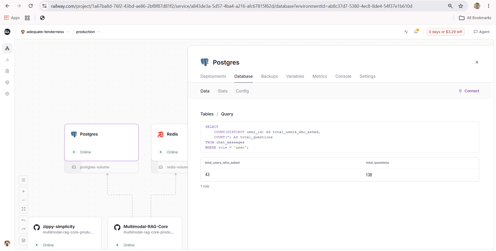

# Multimodal RAG Core

**A production-deployed, multilingual document Q&A application.** Multimodal RAG Core combines a Next.js interface with a FastAPI retrieval pipeline so users can ask grounded questions about documents in English or Arabic.

It was built around practical engineering concerns: conversation-scoped document isolation, source-aware answers, encrypted user-managed model keys, and production operations with PostgreSQL, Redis, and Docker.

## At a glance

- **Grounded document Q&A:** retrieves relevant passages and returns source metadata, including filenames and page references.
- **Multimodal input:** supports PDF, text, Markdown, and common image formats, including image-based questions and optional OCR.
- **Conversation isolation:** each user's conversations have independent document stores.
- **Flexible model configuration:** Gemini or OpenRouter, with encrypted per-user API keys and provider/model selection.
- **Production safeguards:** Google sign-in, JWT access and refresh tokens, ownership checks, rate limits, health/readiness endpoints, and production configuration validation.

## Production usage evidence

The screenshot below captures a query against the deployed PostgreSQL database. At the time it was captured, the `chat_messages` table contained **138 user messages from 43 distinct users who had sent a message**. This demonstrates recorded use of the deployed application; it does not by itself establish user retention, satisfaction, or broader impact.



## Demo

Take a two-minute walkthrough of Multimodal RAG Core:

https://github.com/user-attachments/assets/2979fb63-2aec-4ca4-9a07-991ea99a8336

## Product flow

```text
Sign in with Google
       |
       v
Create or select a conversation
       |
       v
Upload documents / ask a question
       |
       v
Extract, chunk, and retrieve relevant content
       |
       v
Generate an answer with source metadata
```

Each Google account receives one server-provided free question. Further usage requires the user to configure a supported API key.

## Architecture

```text
Next.js 15 + React 19
Google OAuth / conversations / model settings
                 | HTTPS / JWT
                 v
FastAPI application -------- PostgreSQL
auth / uploads / chat        users / sessions / chat history
        |
        +-- Conversation-scoped RAG data
        |   SQLite chunks + FAISS vector index
        +-- Redis (caching / rate limiting)
        +-- Gemini or OpenRouter model
```

Conversation data is stored independently for each user and conversation:

```text
<UPLOAD_DIR>/<user_id>/conversations/<conversation_id>/
+-- uploads/
+-- rag.sqlite3
+-- faiss_index/                 # vector search index
```

In production, PostgreSQL stores users, sessions, and chat history; uploaded files and conversation RAG stores use the persistent backend data volume.

## Features and stack

| Area | Implementation |
| --- | --- |
| Authentication | Google OAuth; JWT access and refresh tokens |
| Conversations | Saved history, ownership checks, isolated documents, per-conversation retrieval |
| Files | PDF, TXT, Markdown, PNG, JPG/JPEG, TIFF, BMP, GIF; 2 MB upload and image-attachment cap |
| Extraction | PDF text extraction; optional Tesseract OCR for images |
| Retrieval | SQLite-backed chunks, LangChain, FAISS, sentence-transformers |
| Document processing | pypdf, Pillow, optional Tesseract OCR |
| Models | Google Gemini and OpenRouter; text and image prompts |
| User model settings | Encrypted per-user API keys, provider/model selection, and enablement |
| API / frontend | FastAPI, Uvicorn/Gunicorn, Pydantic; Next.js 15, React 19, TypeScript, Lucide |
| Operations | PostgreSQL, Redis, Docker Compose, Railway-compatible configuration; health, readiness, and metrics endpoints |

## Production deployment

The application is currently hosted on Railway. Availability may be temporary.

- **Frontend:** [Open the deployed application](https://multimodal-rag-core-production-4615.up.railway.app/)
- **Backend/API:** the public URL is not stored in this repository. Set `NEXT_PUBLIC_API_URL` to the deployed backend's public HTTPS URL.

The documented Railway setup uses four services: **backend**, **frontend**, **PostgreSQL**, and **Redis**.

| Service | Railway configuration |
| --- | --- |
| Backend | Root `/`; Dockerfile `docker/Dockerfile`; health check `/health` |
| Frontend | Root `/frontend`; build `npm run build`; start `npm start` |
| PostgreSQL / Redis | Railway-managed services with referenced variables |

Attach a persistent backend volume at `/app/data` for uploads, SQLite RAG stores, and FAISS indexes. The Railway entrypoint runs `alembic upgrade head` before the API starts. Rebuild the frontend after changing `NEXT_PUBLIC_API_URL`, which Next.js exposes at build time. Set `ALLOWED_ORIGINS` to the exact public frontend origin. Complete Google OAuth client ID and origin/redirect configuration once both public URLs are available; no redirect URI is assumed here.

Docker Compose also provides a production-like local setup:

```bash
docker compose up --build
docker compose -f docker-compose.production.yml up -d --build
```

Production requires PostgreSQL, Redis, a unique JWT secret of at least 32 characters, a valid Fernet provider-encryption key, and safe CORS origins. The backend validates these settings at startup.

The private `GET /metrics` endpoint reports aggregate production usage without message content or provider secrets. Configure `ADMIN_METRICS_TOKEN` in Railway and pass it in the `X-Metrics-Token` header; do not commit it or put it in a URL. User records include `created_at`, `last_login_at`, `last_seen_at`, and `login_count`.

For example, from Git Bash:

```bash
curl -H "X-Metrics-Token: $ADMIN_METRICS_TOKEN" <RAILWAY_BACKEND_HTTPS_URL>/metrics
```

## Run locally

### Prerequisites

- Python 3.10+
- Node.js 18.18+ and npm
- Google OAuth Web Client ID
- Gemini or OpenRouter API key for the server-provided free question
- Tesseract only if image OCR is needed

### Install

```powershell
python -m venv .venv
.\.venv\Scripts\Activate.ps1
pip install -r backend/requirements.txt
pip install -r requirements-dev.txt  # optional test and load-test tooling
cd frontend
npm install
cd ..
```

Copy `.env.example` to `backend/.env` (never commit it):

```dotenv
APP_ENV=development
GOOGLE_OAUTH_CLIENT_ID=your-google-oauth-web-client-id.apps.googleusercontent.com
GOOGLE_API_KEY=your-server-gemini-api-key
GOOGLE_MODEL=gemini-2.5-flash
LLM_PROVIDER=google
EMBEDDING_PROVIDER=local
USE_VECTOR_DB=true
ALLOWED_ORIGINS=http://localhost:3000,http://127.0.0.1:3000
```

Create `frontend/.env.local`:

```dotenv
NEXT_PUBLIC_API_URL=http://localhost:8000
NEXT_PUBLIC_GOOGLE_OAUTH_CLIENT_ID=your-google-oauth-web-client-id.apps.googleusercontent.com
```

Use the same OAuth client ID in both files. To use OpenRouter as the server provider, set `LLM_PROVIDER=openrouter`, `OPENROUTER_API_KEY`, and `OPENROUTER_MODEL`.

### Start

From the repository root:

```powershell
python run.py
```

Or run the API and frontend separately:

```powershell
# terminal 1, from repository root
.\.venv\Scripts\python.exe -m uvicorn backend.app:app --host 127.0.0.1 --port 8000

# terminal 2
cd frontend
npm run dev
```

Open `http://localhost:3000`. API endpoints: health at `/health`, readiness at `/ready`, interactive docs at `/docs`, and metrics at `/metrics` (all on port 8000).

Recommended release checks: confirm `/health` and `/ready`, sign in with Google, upload a small PDF or text file and ask a grounded question, check that citations match the filename and page, and verify that production CORS allows only the public frontend origin.

## Repository layout

```text
backend/                 # FastAPI routes, configuration, RAG pipeline, providers, database
frontend/                # Next.js application
tests/                   # API, RAG, security, and scale tests
docker/                  # backend image and container entrypoint
alembic/                 # database migrations
docker-compose*.yml       # local and production-like services
run.py                    # local development launcher
.env.example              # environment template
```

## Verification

```powershell
python -m pytest tests -q
cd frontend
npm run build
```

Optional load test, with the backend running:

```powershell
locust -f tests/load/locustfile.py --host http://localhost:8000
```

## Security notes

- Never commit environment files, API keys, uploads, databases, or vector indexes. Rotate a key if it appears in a commit, terminal capture, screenshot, or chat.
- Use HTTPS and exact origins in `ALLOWED_ORIGINS` in production.
- Back up PostgreSQL, Redis, and the `/app/data` volume according to your retention policy.
- Authenticated API routes check ownership of conversations and documents. The upload limit is intentionally capped at 2 MB, even if an environment setting is higher.

## License

MIT License.
